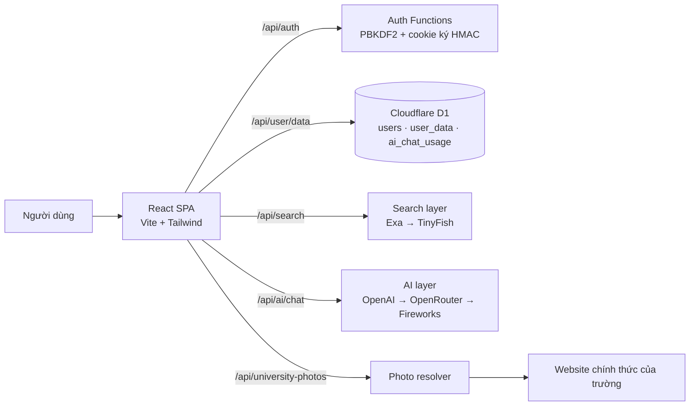

<div align="center">

# SMARM

**Nền tảng định hướng nghề nghiệp và tuyển sinh dành cho học sinh Việt Nam**

Từ một bài trắc nghiệm tính cách đến một kế hoạch học tập cụ thể — tất cả trong cùng một ứng dụng.

[](https://smarm.pages.dev)


</div>

---

## Giới thiệu

Mỗi năm, hàng trăm nghìn học sinh lớp 12 phải tự trả lời ba câu hỏi lớn: **mình hợp với nghề gì, nên học trường nào, và cần chuẩn bị những gì**. Thông tin thì nằm rải rác ở hàng chục website, phần lớn đã cũ, thiếu nguồn, hoặc chỉ đưa ra lời khuyên chung chung.

SMARM gom toàn bộ quá trình đó vào một luồng duy nhất:

1. Làm bài trắc nghiệm Holland 60 câu để hiểu tính cách và nhóm nghề phù hợp.
2. Nhận danh sách nghề được xếp theo mức độ phù hợp, không đảo lộn mỗi lần tải lại.
3. Tìm trường đại học đào tạo đúng ngành, lọc theo tiêu chí riêng như khu vực và học phí.
4. Đọc báo cáo tuyển sinh chi tiết: điểm chuẩn, phương thức xét tuyển, tổ hợp môn, học phí, học bổng.
5. So sánh các trường đã lưu, xem góc nhìn cộng đồng và nhận tư vấn trực tiếp từ trợ lý AI.
6. Theo dõi điểm số, mục tiêu và lịch ôn thi trên cùng một màn hình.

Toàn bộ dữ liệu học sinh được lưu theo tài khoản, nên lần sau đăng nhập lại vẫn còn nguyên.

**Bản đang chạy:** https://smarm.pages.dev

---

## Tính năng chính

| Khu vực | Chức năng |
| --- | --- |
| **Tư vấn** | Trắc nghiệm Holland 60 câu · báo cáo nhóm tính cách · gợi ý nghề theo trọng số 12/8/4 · tìm trường theo ngành và tiêu chí riêng · báo cáo tuyển sinh chi tiết kèm nguồn |
| **Học tập** | Nhập điểm học bạ và điểm thi · phân tích theo tổ hợp A00, A01, D01… · tính điểm mục tiêu cần đạt · nhận xét dựa trên số liệu thật |
| **Lộ trình** | Đếm ngược kỳ thi · thời gian biểu theo thứ · danh sách việc cần làm |
| **Góc nhìn** | Tổng hợp đánh giá, trải nghiệm thực tế của sinh viên về từng trường |
| **So sánh** | So sánh song song các trường đã lưu theo học phí, điểm chuẩn, phương thức xét tuyển, cơ hội việc làm |
| **Smarm AI** | Trợ lý hội thoại streaming, trả lời có ngữ cảnh hồ sơ, hỗ trợ công thức toán bằng KaTeX, giới hạn 12 lượt mỗi ngày |
| **Cài đặt** | Xem lại kết quả Holland · làm lại bài test · đăng xuất |

Ngoài ra:

- **Ảnh trường chính thống** — ảnh được lấy từ chính website của trường, có kiểm tra kích thước và loại bỏ logo, banner, ảnh trang trí.
- **Tìm kiếm thời gian thực** — dữ liệu tuyển sinh được truy xuất theo từng truy vấn thay vì đọc từ một bảng cứng đã lỗi thời.
- **Giao diện mobile-first** — thanh điều hướng dạng lưới 7 cột, tôn trọng vùng an toàn của iPhone, không tràn ngang.
- **Chịu lỗi** — nếu một nguồn tìm kiếm hoặc một lượt gọi AI thất bại, ứng dụng vẫn hiển thị thông tin cơ bản thay vì chặn toàn bộ luồng.

---

## Kiến trúc



Frontend và backend chạy chung một dự án Cloudflare Pages: phần giao diện là SPA tĩnh, phần API là Pages Functions đặt trong thư mục `functions/`. Mọi khoá bí mật chỉ tồn tại ở phía máy chủ dưới dạng biến môi trường.

---

## Công nghệ sử dụng

**Giao diện**

- React 19 + TypeScript, điều hướng bằng React Router 7
- Vite 6, Tailwind CSS v4
- Motion cho chuyển động, Lucide cho biểu tượng
- React Markdown + remark-gfm + remark-math + KaTeX để hiển thị báo cáo và công thức

**Máy chủ**

- Cloudflare Pages Functions (chạy trên Workers runtime)
- Cloudflare D1 (SQLite) cho tài khoản và dữ liệu người dùng
- Lớp AI dự phòng nhiều nhà cung cấp: OpenAI, OpenRouter, Fireworks
- Lớp tìm kiếm dự phòng: Exa (luân phiên nhiều khoá) rồi TinyFish
- Xác thực bằng PBKDF2-SHA256 (100.000 vòng) và cookie phiên HttpOnly ký HMAC

---

## Cấu trúc thư mục

```text
SMARM/
├── functions/              # Cloudflare Pages Functions (API)
│   ├── api/
│   │   ├── ai/chat.ts      # Hội thoại AI, streaming SSE
│   │   ├── auth/           # Đăng ký, đăng nhập, đăng xuất, phiên
│   │   ├── search.ts       # Tìm kiếm web có dự phòng nhiều nhà cung cấp
│   │   ├── university-photos.ts
│   │   └── user/data.ts    # Đọc và ghi dữ liệu người dùng
│   └── lib/                # AI, tìm kiếm, xác thực, tiện ích dùng chung
├── migrations/             # Câu lệnh tạo bảng D1
├── public/                 # Tệp tĩnh, _redirects cho SPA
├── src/
│   ├── components/         # Thành phần dùng chung
│   ├── data/               # Bộ câu hỏi Holland, nhóm nghề, danh ngôn
│   ├── lib/                # Gọi API, lưu dữ liệu, tìm trường, media
│   └── pages/
│       ├── Home.tsx        # Trang giới thiệu
│       ├── Auth.tsx        # Đăng ký / đăng nhập
│       ├── Test.tsx        # Bài trắc nghiệm Holland
│       ├── Dashboard.tsx   # Khung ứng dụng và thanh điều hướng
│       └── tabs/           # Bảy khu vực chức năng
├── scripts/                # Bước hậu xử lý khi build
├── wrangler.toml           # Cấu hình Pages, D1
└── .env.example            # Danh sách biến môi trường, không chứa giá trị thật
```

---

## Chạy trên máy

### 1. Yêu cầu

- Node.js 20 trở lên
- Tài khoản Cloudflare (chỉ cần khi muốn chạy mô phỏng D1 hoặc triển khai)

### 2. Cài đặt

```bash
git clone https://github.com/dev-hkm/SMARM.git
cd SMARM
npm install
```

### 3. Biến môi trường

Sao chép tệp mẫu và điền giá trị của bạn:

```bash
cp .env.example .dev.vars
```

| Biến | Bắt buộc | Mô tả |
| --- | --- | --- |
| `AUTH_SECRET` | Có | Chuỗi ngẫu nhiên dùng để ký cookie phiên |
| `RIVER_API_KEY` | Không | Khoá River, được ưu tiên gọi trước OpenAI khi có mặt |
| `OPENAI_API_KEY` | Một trong ba | Khoá OpenAI cho lớp AI chính |
| `OPENROUTER_API_KEY` | Một trong ba | Khoá OpenRouter cho lớp AI dự phòng |
| `FIREWORKS_API_KEY` | Một trong ba | Khoá Fireworks cho lớp AI dự phòng |
| `EXA_API_KEY` | Một trong hai | Khoá Exa cho tìm kiếm; có thể thêm `EXA_API_KEY_2`, `EXA_API_KEY_3` |
| `TINYFISH_API_KEY` | Một trong hai | Khoá TinyFish cho lớp tìm kiếm dự phòng |
| `OPENAI_MODEL` | Không | Ghi đè mô hình mặc định |
| `OPENAI_FALLBACK_MODEL` | Không | Mô hình dự phòng khi mô hình chính lỗi |
| `OPENAI_REASONING_EFFORT` | Không | Mức suy luận: `minimal`, `low`, `medium`, `high` |
| `RIVER_MODEL` | Không | Ghi đè mô hình River (mặc định `zai-org/GLM-5.3-Flash`) |
| `RIVER_FALLBACK_MODEL` | Không | Mô hình River dự phòng |

> Không bao giờ đưa `.dev.vars` lên Git. Tệp này đã nằm trong `.gitignore`.

Nếu không muốn sửa tệp bằng tay, chạy `npm run key:setup` để mở form trên localhost và dán khoá River; form tự ghi vào `.dev.vars`.

### 4. Khởi tạo cơ sở dữ liệu

```bash
npm run db:migrate:local
```

### 5. Chạy

```bash
npm run pages:dev
```

Lệnh này build giao diện rồi khởi động Cloudflare Pages kèm Functions và D1 cục bộ. Địa chỉ truy cập sẽ hiện trong terminal.

Các lệnh khác:

| Lệnh | Tác dụng |
| --- | --- |
| `npm run dev` | Chỉ chạy Vite, không có API |
| `npm run lint` | Kiểm tra kiểu bằng TypeScript |
| `npm run build` | Build bản production vào `dist/` |
| `npm run deploy` | Build và triển khai lên Cloudflare Pages |

---

## Triển khai lên Cloudflare Pages

```bash
# Tạo cơ sở dữ liệu D1, sau đó điền database_id vào wrangler.toml
npx wrangler d1 create smarm-db

# Áp dụng bảng
npm run db:migrate

# Khai báo bí mật, mỗi lệnh sẽ hỏi giá trị
npx wrangler pages secret put AUTH_SECRET --project-name smarm
npx wrangler pages secret put RIVER_API_KEY --project-name smarm
npx wrangler pages secret put OPENAI_API_KEY --project-name smarm
npx wrangler pages secret put EXA_API_KEY --project-name smarm

# Triển khai
npm run deploy
```

Frontend và API được đóng gói chung trong một lần triển khai, không cần cấu hình CORS.

---

## API

| Phương thức | Đường dẫn | Chức năng |
| --- | --- | --- |
| `POST` | `/api/auth/register` | Tạo tài khoản, trả cookie phiên |
| `POST` | `/api/auth/login` | Đăng nhập |
| `POST` | `/api/auth/logout` | Huỷ phiên |
| `GET` | `/api/auth/session` | Kiểm tra phiên hiện tại |
| `GET` / `PUT` | `/api/user/data` | Đọc và ghi dữ liệu học sinh |
| `POST` | `/api/ai/chat` | Hội thoại AI, hỗ trợ streaming SSE và ép định dạng JSON |
| `POST` | `/api/search` | Tìm kiếm web có dự phòng nhiều nhà cung cấp |
| `POST` | `/api/university-photos` | Lấy ảnh chính thống của trường |

Mọi endpoint AI, tìm kiếm và ảnh đều yêu cầu phiên đăng nhập hợp lệ.

---

## Bảo mật và quyền riêng tư

- Mật khẩu được băm bằng PBKDF2-SHA256 với 100.000 vòng lặp và muối riêng cho từng tài khoản.
- Phiên đăng nhập là cookie `HttpOnly`, `SameSite=Lax`, có chữ ký HMAC-SHA256.
- Toàn bộ khoá API nằm ở phía máy chủ; mã nguồn giao diện không chứa khoá nào.
- Giới hạn 12 lượt trò chuyện AI mỗi ngày cho mỗi tài khoản để tránh lạm dụng.
- Dữ liệu học sinh chỉ được trả về cho chính chủ tài khoản đang đăng nhập.
